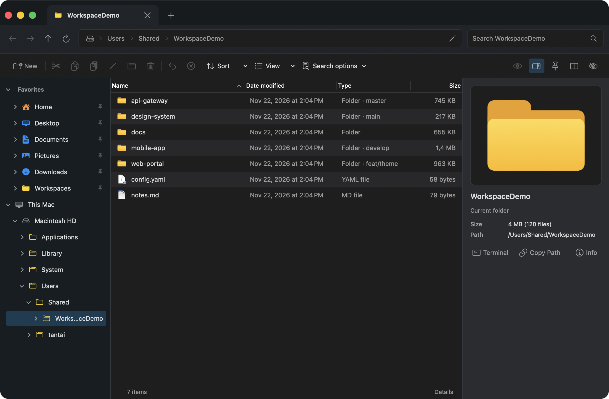
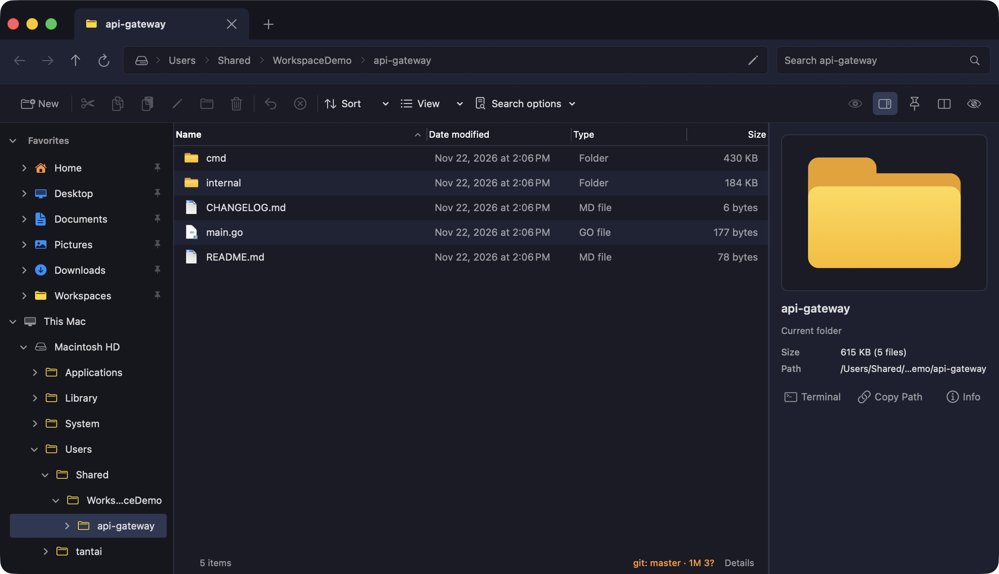

<p align="center">
  
</p>

<h1 align="center">MacExplorer</h1>

<p align="center">
  A fast, native Swift + AppKit file manager for macOS 14+ with zero external dependencies.<br>
  Dual panes, multi-theme dark palettes, real POSIX folder sizes, inline preview &amp; inspector, Git status badges, advanced search, batch rename, and Quick Jump.
</p>

<p align="center">
  <strong>macOS 14+ · Swift 6 · Universal (Apple Silicon + Intel) · MIT License</strong>
</p>

---



## Highlights

- **Native speed & low resource footprint:** Built directly on Swift 6 and AppKit with zero third-party dependencies. Background folder sizing uses Darwin POSIX `fts_open` with in-flight coalescing and background QoS so idle CPU drops to `0%`.
- **5 curated color themes:** `Slate Cyan` (default), `Tokyo Night`, `Nord`, `Catppuccin Mocha`, and `System Default`, switchable live from Settings, the View menu, or Quick Jump (`⌘K`).
- **Right-side Preview & Inspector (`⌥⌘P`):** Instant syntax-readable code/text preview (up to 32 KB), Quick Look thumbnails, real aggregated folder size & item count, Finder color tag dots, and one-click `Terminal`, `Copy Path`, and `Info` actions.
- **Git-aware browsing:** Detects Git branches on folders (`Folder · master`, `Folder · feat/theme`) and shows live working-tree status (`git: master · 1M 3?`) in the footer bar.
- **Fast structured search (`⌘F` / `⇧⌘F`):** Supports tokens `ext:swift,go`, `size:>1mb`, `mod:<7d`, `type:folder`, `type:file`, `regex:...`, and `content:...`. Automatically skips noisy build/dependency directories (`node_modules`, `.git`, `.build`, `DerivedData`, `Pods`, `__pycache__`, `.venv`) and binary files during content scans.
- **Developer workflow tools:**
  - **Quick Jump (`⌘K`):** Fuzzy palette for favorites, open tabs, themes, and workspace commands.
  - **Batch Rename (`F2` / `Return` on multi-selection):** Live side-by-side preview for Find & Replace (regex supported), Prefix / Suffix, and Sequence numbering with duplicate validation and single-shot `⌘Z` Undo.
  - **Drag-and-drop Favorites & Dual Panes (`⇧⌘D`):** Reorder pinned Favorites directly in the sidebar, drag folders to pin them, and transfer files across split panes.
  - **Custom folder icon rules (`~/.config/explorer/folder-rules.json`):** Assign custom colors and SF Symbol badges to folders by `root` + `depth`, `pathRegex`, or `nameRegex` without writing `Icon\r` or extended attributes to disk. Compiled once at load time with bounded vector icon caching and automatic hot-reload.
  - **Full file operations with Undo:** Copy, Cut, Paste, Move, Rename, New Folder/File, Trash, ZIP Compress/Extract, conflict resolution, and Finder color labels.



## Build and install

Requires **macOS 14+** and a **Swift 6 toolchain** (Xcode or Xcode Command Line Tools).

```sh
git clone https://github.com/nguyentantai21042004/MacExplorer.git
cd MacExplorer
zsh scripts/build.sh --universal
ditto build/Explorer.app /Applications/Explorer.app
open /Applications/Explorer.app
```

Run the full test suite:

```sh
zsh scripts/test.sh
```

## Optional: Use as default file viewer (`Reveal in Finder`)

Explorer coexists safely alongside macOS Finder. To route `Reveal in Finder` calls from apps such as VS Code, Cursor, Chrome, and Raycast to Explorer:

```sh
defaults write -g NSFileViewer -string io.bquick.explorer
```

To revert back to Finder at any time:

```sh
defaults delete -g NSFileViewer
```

You can also toggle the system default folder handler inside **Explorer → Settings… → Applications → Set as Default…**.

## Keyboard shortcuts

| Action | Shortcut |
| --- | --- |
| Bring Explorer forward | `⌘E` (configurable) |
| Quick Jump palette | `⌘K` |
| Toggle Preview & Inspector panel | `⌥⌘P` |
| Toggle Dual Panes / Switch pane | `⇧⌘D` / `F6` |
| Search / Recursive search | `⌘F` / `⇧⌘F` |
| Edit breadcrumb path | `⌘L` |
| New tab / Close tab | `⌘T` / `⌘W` |
| Rename / Batch Rename (multi-select) | `F2` or `Return` |
| Quick Look preview | `Space` |
| Native Get Info (Properties) | `⌘I` |
| Pin / Unpin current folder | `⌘D` |
| Toggle hidden files | `⇧⌘.` |
| Undo last file operation | `⌘Z` |

## Attribution & license

Forked and customized from [binaryquest/MacExplorer](https://github.com/binaryquest/MacExplorer) by [Sazzad Hossain](https://github.com/djad442) at Binary Quest (with multilingual packs contributed by [andyzoer](https://github.com/andyzoer)). Released under the [MIT License](LICENSE).
